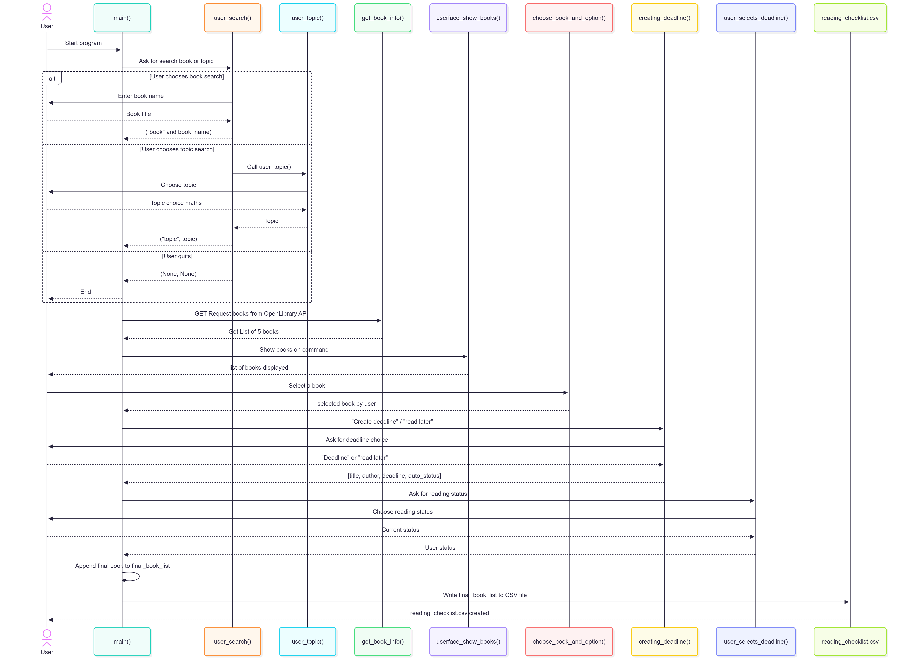

# Book Recommendation and Reading Tracker

---
## Aim of the project

The aim of this project is to help users find books:
1. A book of their choice
2. A book that is recommeneded via topic_choice
The project uses a OpenLibary API to retrive book data allowing users to select books, deadline  and manage their reading, and finally save it all into a CSV file.

---
## Importance of project

- This project helps users stay organised with thier reading.
- Allows users to stay consistence and meeet personal deadline.
- - Not only does the program set a deadline for the user:
  - the user can also select their status.
  - users can select a deadline
  - or the programs generate it for them allowing them to manage thier reading.
    
It filters the API into topic or allows users to quickly retrive a book choice of their own. 
- The program allows users to keep track of their reading acting as its own personal database
- Have the ability to set time after selecting a book thus allowing them to visualise thier personal growth.

---
# API used:
The project uses the OpenLibrary Search API:
` https://openlibrary.org/search.json`
- API used to filter, retrive data extracting

---

| Functional Requirements                                      | Non-Functional Requirements                    |
|------------------------------------------------------------|----------------------------------------------|
| Search for a specific book of their choice        |  Easy to use      |
|  Get book recommendations based on a topic         | Should handle errors                         |
| Retrieves data from an API                                  | Make it Readable          |
| Users can select a book from a list                         | Should run              without crashing      |
| The program saves results to a CSV file                     |                                              |

# How the porgam works:
1. install pip install -r requirements.txt
2. Run the program: python reading_book_tracker.py

## Technical Implementation

- **Control Flow:** Implemented conditional statements and loops to manage user interactions.
- **Data Structures:** Utilised Python lists, dictionaries and tuples to store and manage book-related data.
- **Modular Programming:** Developed reusable functions to structure application logic.
- **Data Processing:** Applied string manipulation to format book information.
- **REST API Integration:** Retrieved book information from the Open Library API and processed JSON responses.
- **Data Persistence:** Exported reading records to CSV files.
- **Python Libraries:** Utilised `requests`, `datetime` and `csv`.

# Personal Improvement:

Initally I created a function that was commited to more than 1 single responsibilty, going against the **Single Responsibility Principle (srp)**. I created my own **code smell**  :skunk:
To resolve this, i went for an iteratie approach where I  refractored the code separting it so that it has 1 single responsibilty whilst applying **modular programming**.

# Sequnce diagram

## Sequence Diagram

   

